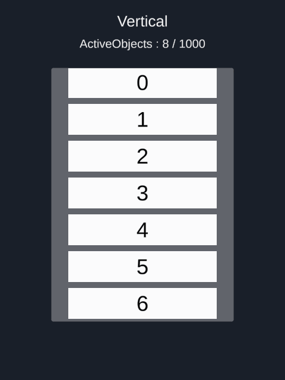
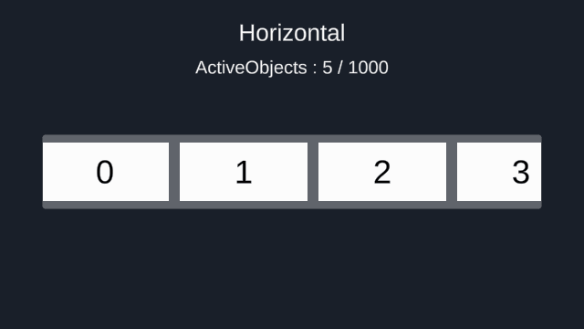
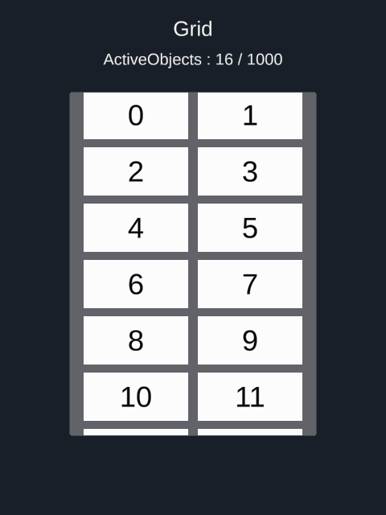
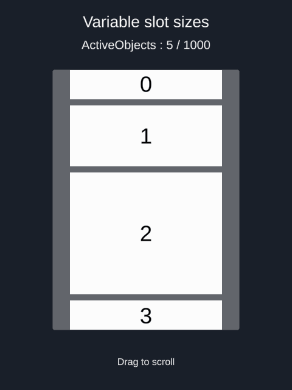
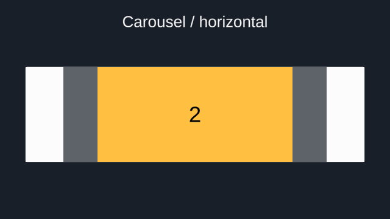
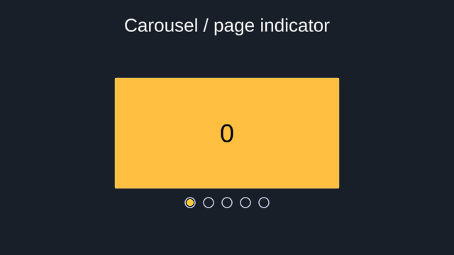
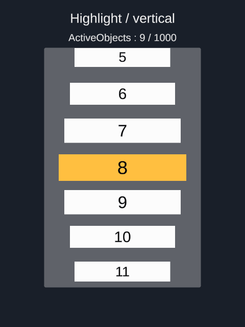
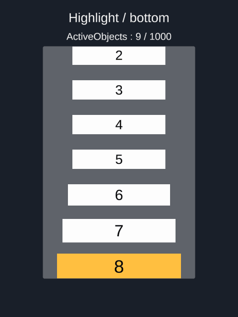
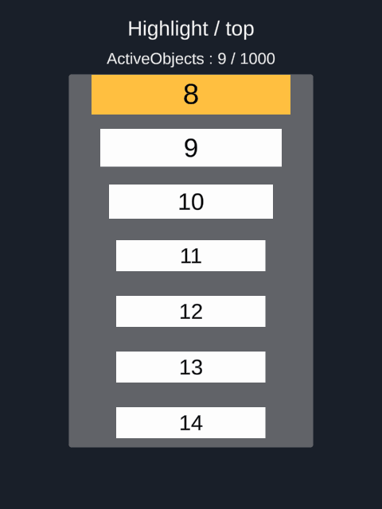
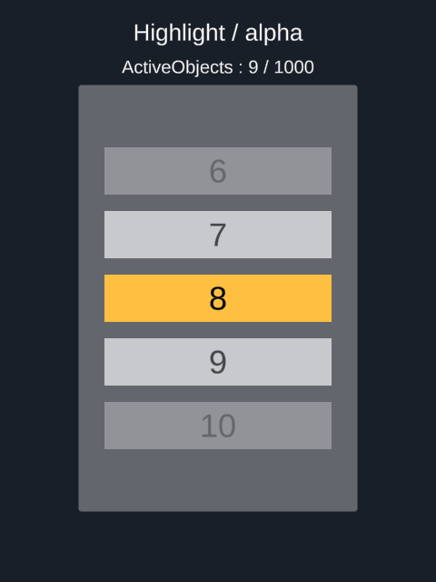

# Recycle Scroll View

화면에 보이는 슬롯을 재사용하는 Unity uGUI 스크롤뷰입니다. <br>
세로·가로·그리드 배치, 가변 크기, Carousel·Highlight 등 여러 효과를 지원합니다.

## 설치

Unity · uGUI 2.0.0

**Window → Package Manager → Install package from Git URL**
```text
https://github.com/chanchung2/RecycleScrollView.git?path=/Packages/RecycleScrollView
```

## 사용 예시

**GameObject → UI (Canvas) → RecycleScrollView**로 생성합니다.

ScrollView에 사용할 오브젝트는 `ScrollSlot`을 상속받아야 합니다.<br>
아래 예시에서는 다음 `NumberSlot`을 사용합니다.

```csharp
using RecycleScrollView;
using TMPro;
using UnityEngine;

public sealed class NumberSlot : ScrollSlot
{
    [SerializeField]
    private TMP_Text _label;

    public void Bind(int index)
    {
        _label.SetText("{0}", index);
    }
}
```

크기 설정 방식에 따라 메소드를 선택합니다.

| 메소드 | 크기 설정 |
| :--- | :--- |
| `UpdateScrollView` | 슬롯 프리팹의 크기 사용 |
| `UpdateScrollViewWithSizes` | 항목별 크기 목록을 직접 전달 |

### UpdateScrollView

스크롤뷰와 프리팹을 연결하고 아이템 개수를 전달합니다.

```csharp
using RecycleScrollView;
using UnityEngine;
using ScrollView = RecycleScrollView.RecycleScrollView;

public sealed class NumberList : MonoBehaviour
{
    [SerializeField]
    private ScrollView _scrollView;
    [SerializeField]
    private GameObject _slotPrefab;

    private void Start()
    {
        const int ItemCount = 1000;

        _scrollView.UpdateScrollView(_slotPrefab, ItemCount, (obj, index) =>
        {
            if (obj is NumberSlot slot)
            {
                slot.Bind(index);
            }
        });
    }
}
```

배치 방향은 **Scroll Layout Group**에서 설정합니다.

| 세로 | 가로 | 그리드 |
| :---: | :---: | :---: |
|  |  |  |

### UpdateScrollViewWithSizes

크기를 미리 알고 있다면 `UpdateScrollViewWithSizes`를 사용합니다.<br>

```csharp
private void Start()
{
    const float SlotWidth = 250;
    const float SmallSlotHeight = 50;
    const float MediumSlotHeight = 100;
    const float LargeSlotHeight = 200;

    var slotSizes = new[]
    {
        new Vector2(SlotWidth, SmallSlotHeight),
        new Vector2(SlotWidth, MediumSlotHeight),
        new Vector2(SlotWidth, LargeSlotHeight)
    };
    _scrollView.UpdateScrollViewWithSizes(_slotPrefab, slotSizes, (obj, index) =>
    {
        if (obj is NumberSlot slot)
        {
            slot.Bind(index);
        }
    });
}
```



이후 크기가 바뀌면 `SetSlotSize(index, size)`로 갱신할 수 있습니다.

```csharp
_scrollView.SetSlotSize(index, new Vector2(slotWidth, slotHeight));
```


## Carousel 모드

드래그를 놓으면 설정한 `Alignment` 기준 위치에 가장 가까운 항목으로 이동합니다.<br>
`CarouselScrollMode`를 상속하고 `UpdateSlotEffect`에서 선택된 슬롯의 연출을 구현할 수 있습니다.<br>
`state`로 항목 번호, 선택 여부, 기준 위치까지의 거리를 받을 수 있습니다.

아래는 슬롯의 `Image` 색상을 바꾸는 예시입니다.

**적용**

```csharp
const float CenterAlignment = .5f;
var colorCarouselScrollMode = new ColorCarouselScrollMode(alignment: CenterAlignment);
_scrollView.SetScrollMode(colorCarouselScrollMode);
```

**구현**

```csharp
using RecycleScrollView;
using UnityEngine;

public class ColorCarouselScrollMode : CarouselScrollMode
{
    private const float CenterAlignment = .5f;
    private static readonly Color s_highlightColor = new Color(1, .75f, .25f);

    public ColorCarouselScrollMode(float alignment = CenterAlignment) : base(alignment: alignment)
    {
    }

    protected override void UpdateSlotEffect(ScrollSlot slot, CarouselSlotState state)
    {
        var image = slot.GetComponent<UnityEngine.UI.Image>();
        if (image == null)
        {
            return;
        }

        if (!state.IsActive)
        {
            image.color = Color.white;
            return;
        }

        image.color = Color.white;
        if (state.IsSelected)
        {
            image.color = s_highlightColor;
        }
    }
}
```


슬롯 반환이나 모드 해제 시 `IsActive = false`가 전달됩니다. 위 분기에서 원래 색으로 복원합니다.

### Carousel 자동 배너

이번 예시는 Carousel을 활용하여 자동으로 순차 재생되는 배너 연출입니다.
```csharp
using System.Collections;
using UnityEngine;
using ScrollView = RecycleScrollView.RecycleScrollView;

namespace RecycleScrollView.Samples
{
    public class CarouselAutoScrollSample : MonoBehaviour
    {
        private const float DefaultInterval = 2;
        private const int MinimumItemCount = 2;

        [SerializeField]
        private ScrollView _scrollView;
        [SerializeField]
        private float _interval = DefaultInterval;

        private Coroutine _autoScrollCoroutine;
        private int _index;

        private void OnEnable()
        {
            _autoScrollCoroutine = StartCoroutine(AutoScroll());
        }

        private void OnDisable()
        {
            if (_autoScrollCoroutine != null)
            {
                StopCoroutine(_autoScrollCoroutine);
                _autoScrollCoroutine = null;
            }
        }

        private IEnumerator AutoScroll()
        {
            var wait = new WaitForSeconds(_interval);
            while (true)
            {
                yield return wait;

                int itemCount = _scrollView.DataCount;
                if (itemCount < MinimumItemCount)
                {
                    _index = 0;
                    continue;
                }

                _index = (_index + 1) % itemCount;
                if (_index == 0)
                {
                    _scrollView.ImmediateToSlotIndex(_index);
                }
                else
                {
                    _scrollView.ScrollToSlotIndex(_index);
                }
            }
        }
    }
}
```

일정 시간마다 index를 올려주고, 이 index를 배너의 인덱스로 전달 합니다.<br>
`ImmediateToSlotIndex(index)`는 즉시, `ScrollToSlotIndex(index)`는 부드럽게 이동합니다.

**현재 페이지 표시**

**적용**

```csharp
var carousel = new ColorCarouselScrollMode();
_scrollView.SetScrollMode(carousel);
```

**구현**

```csharp
using UnityEngine;
using UnityEngine.UI;

namespace RecycleScrollView.Samples
{
    public class CarouselPageIndicatorSample : MonoBehaviour
    {
        [SerializeField]
        private Image[] _fills;

        private CarouselScrollMode _mode;

        public void Initialize(CarouselScrollMode mode)
        {
            Unsubscribe();
            _mode = mode;
            if (isActiveAndEnabled)
            {
                Subscribe();
            }
        }

        private void OnEnable()
        {
            Subscribe();
        }

        private void OnDisable()
        {
            Unsubscribe();
        }

        private void Subscribe()
        {
            if (_mode == null)
            {
                return;
            }

            _mode.SelectionChanged += UpdateIndicator;
            UpdateIndicator(_mode.SelectedIndex);
        }

        private void Unsubscribe()
        {
            if (_mode != null)
            {
                _mode.SelectionChanged -= UpdateIndicator;
            }
        }

        private void UpdateIndicator(int index)
        {
            for (int i = 0; i < _fills.Length; i++)
            {
                _fills[i].enabled = i == index;
            }
        }
    }
}
```
`SelectionChanged`로 현재 선택된 인덱스를 받을 수 있습니다.



## Highlight 모드

`HighlightScrollMode`를 상속하고 `UpdateSlotEffect`에서 연출을 구현합니다.<br>
`state`로 선택 여부, 크기 비율, 투명도, 기준 위치와의 거리를 받을 수 있습니다.

### 크기 조절

기준 위치에 가까울수록 커지는 예시입니다.

**적용**

```csharp
const float CenterAlignment = .5f;
var scaleHighlightScrollMode = new ScaleHighlightScrollMode(alignment: CenterAlignment);
_scrollView.SetScrollMode(scaleHighlightScrollMode);
```

**구현**

```csharp
using RecycleScrollView;
using UnityEngine;

public class ScaleHighlightScrollMode : HighlightScrollMode
{
    private const float CenterAlignment = .5f;
    private const float DefaultEffectDistance = 200f;
    private const float MinimumScale = .75f;
    private const float MaximumScale = 1f;

    public ScaleHighlightScrollMode(float alignment = CenterAlignment)
        : base(alignment: alignment, effectDistance: DefaultEffectDistance)
    {
    }

    protected override void UpdateSlotEffect(ScrollSlot slot, HighlightSlotState state)
    {
        if (!state.IsActive)
        {
            slot.CacheTransform.localScale = Vector3.one;
            return;
        }

        float scale = Mathf.Lerp(MinimumScale, MaximumScale, state.ScaleBlend);
        slot.CacheTransform.localScale = Vector3.one * scale;
    }
}
```

세로 기준 `Alignment`: **0 = 위 / 0.5 = 가운데 / 1 = 아래**.

| Alignment: 0.5 (가운데) | Alignment: 1 (아래) | Alignment: 0 (위) |
| :---: | :---: | :---: |
|  |  |  |

### 알파로 숨기기

슬롯 프리팹에 **CanvasGroup**을 연결하고 alpha값을 조정해 숨기는 연출도 가능합니다.

**적용**

```csharp
const float CenterAlignment = .5f;
var alphaHighlightScrollMode = new AlphaHighlightScrollMode(alignment: CenterAlignment);
_scrollView.SetScrollMode(alphaHighlightScrollMode);
```

**구현**

```csharp
using RecycleScrollView;
using UnityEngine;

public class AlphaHighlightScrollMode : HighlightScrollMode
{
    private const float CenterAlignment = .5f;
    private const float DefaultEffectDistance = 200f;

    public AlphaHighlightScrollMode(float alignment = CenterAlignment)
        : base(alignment: alignment, effectDistance: DefaultEffectDistance)
    {
    }

    protected override void UpdateSlotEffect(ScrollSlot slot, HighlightSlotState state)
    {
        var group = slot.GetComponent<CanvasGroup>();
        if (!state.IsActive)
        {
            group.alpha = 1;
            return;
        }

        float alpha = 1;
        if (!state.IsSelected)
        {
            alpha = state.ScaleBlend;
        }

        group.alpha = alpha;
    }
}
```


